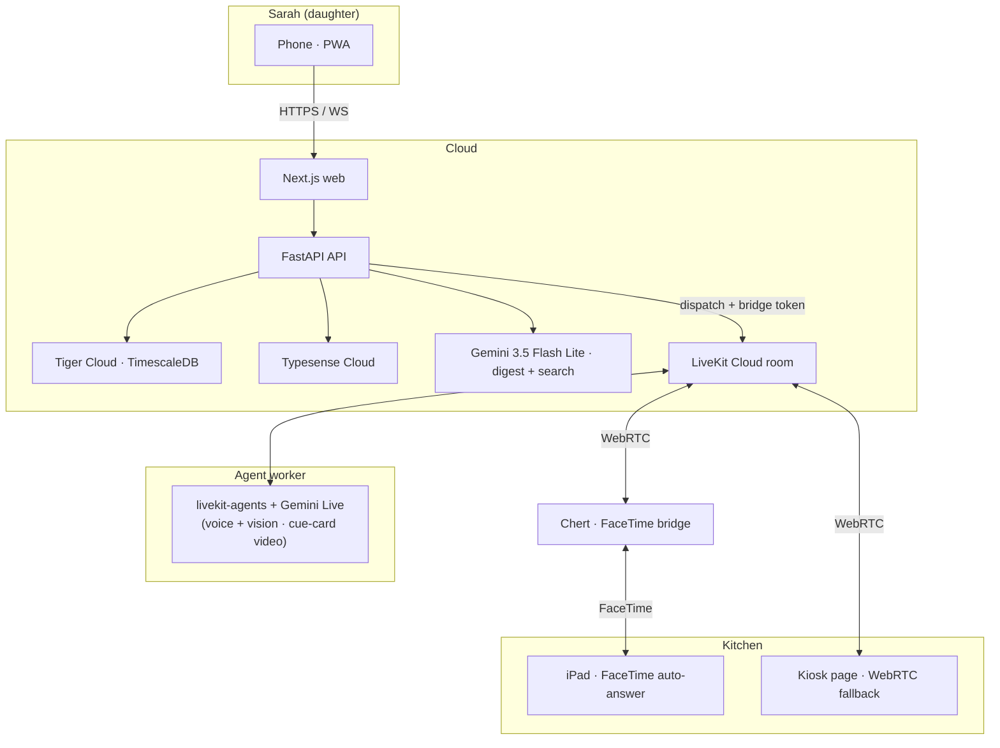

# Memo

[](https://github.com/Davila-bit/memo/actions/workflows/ci.yml)
Accessibility evidence: [docs/ACCESSIBILITY.md](docs/ACCESSIBILITY.md) (axe scans of every page at phone and laptop size, and what is not tested yet).

**The call your mum never has to answer.**

[callyourmother.club](https://callyourmother.club) · also at [grannystalker.health](https://grannystalker.health) and [geezerhood-watch.health](https://geezerhood-watch.health)

Emory Hacks 2026 · Healthcare track

## What it does

Memo is a FaceTime check-in helper for a parent with dementia living alone.
At drink, meal and medication times, the helper calls her auto-answering kitchen iPad,
shows her own mug or the right pill-box slot, watches until it sees her drink, and
tells her daughter it happened. If she refuses or does not answer, the daughter gets
what she said and chooses what to do next.

## How a check-in works

1. A scheduled check-in fires (or the daughter taps "Check on her now").
2. The helper places a FaceTime video call through Chert. The iPad auto-answers.
3. The iPad shows a calm cue card: a photo of her own mug, plate or pill organiser, one line of large text, and live captions.
4. The helper speaks: a short, warm, adult prompt using her preferred name, then waits.
5. When the helper sees her drink, it logs "observed taking" and the daughter's phone updates within seconds. When it can only hear her say she did (no camera on that call), it logs that as "said she did", shown differently and not counted towards the day's fluids. If she refuses, the daughter gets her words and action choices: try again later, call her, or ask a neighbour. If nobody answers, the helper tries once more and then alerts the daughter.

The same helper runs over two transports: a real FaceTime call through Chert, and a browser kiosk page (WebRTC) for tablets without FaceTime and for development.

## Architecture



## Try it in two minutes

Or just open the practice version in your browser: https://davila-bit.github.io/memo/ (passcode `hearth-demo`).

With Node.js 20.9+ and Corepack installed, run this from the repo root. No keys,
backend or Coder workspace are needed: the demo runs entirely in your browser.

```bash
cd web && corepack enable && pnpm install && pnpm dev:mock
```

Open http://localhost:3101 and sign in with passcode `hearth-demo`. Stop the
server with Ctrl+C when finished.

For the Python tests, install Python 3.12 and uv, then run each command from the
repo root. Both suites run without keys; tests that need live services skip.

```bash
cd backend && uv sync && uv run pytest -q tests
```

```bash
cd agent && uv sync && uv run pytest -q
```

`hearth` in package and variable names was the working title. Optional environment
variable names are listed in [`.env.example`](.env.example); the mock demo needs none.

## How we run it (Coder workspace)

Development happens inside **Coder workspaces**. See [`infra/coder/README.md`](infra/coder/README.md) for setup.

```bash
scripts/dev-up --prod            # start API, agent worker and web (production build) in the Coder workspace
scripts/dev-up --public --prod   # same, with cloudflared tunnels so a phone can open it
scripts/dev-down          # stop everything
```

Keys are managed with `fnox`. The names are listed in [`contracts/API.md` §3](contracts/API.md). The app runs with no keys in mock mode (in-memory store, template digest, no calls).

## Tests

```bash
# backend
scripts/ws 'cd backend && uv run pytest -q tests'

# agent
scripts/ws 'cd agent && uv run pytest -q'

# web (e2e + accessibility)
scripts/ws 'cd web && pnpm lint && pnpm exec tsc --noEmit && pnpm e2e'
```

Web e2e tests use Playwright with `@axe-core/playwright`. Every page and state the tests visit is scanned with axe at phone (390x844) and laptop (1280x800) size against the WCAG 2.2 AA rule set, in mock mode. Result: 0 serious or critical issues. No screen-reader pass has been done by hand yet.

## Privacy and safety

- **Not recorded.** No call video, audio or frames are written to disk or cloud storage. Only structured events and short text notes are stored.
- **PII redaction.** Names, phone numbers and addresses are stripped by Presidio from the short evidence notes before they are stored, indexed for search or summarised. Transcripts are never stored.
- **No voice cloning.** The helper identifies itself as "Sarah's helper, an assistant". It never impersonates a family member.
- **No medical advice.** The helper never changes doses, suggests treatments or gives clinical guidance. The schedule is set by the family.
- **Consent and deletion.** A consent record (from the person or their healthcare agent) is stored. All data can be deleted from the privacy page. Events auto-expire after 90 days (Tiger Data retention policy).
- **The helper never dials 911.** In a concern (she says "I fell" or asks for help), the helper tells the daughter, who decides whether to call emergency services herself.
- **Gemini free-tier disclosure.** On Google's free tier, content sent to Gemini may be used to improve Google products ([Google's terms](https://ai.google.dev/gemini-api/terms)). For the demo we use a teammate, not a real patient. A production deployment would use the paid API tier, which does not use content for training.
- **Contacts only.** We recommend the family limit the kitchen iPad to FaceTime calls from contacts (the daughter and the helper's line), so nobody else can reach an auto-answering screen.

## Accessibility

- **Margaret (the parent) needs zero interaction.** The iPad auto-answers; the cue card uses one line of very large text with live captions; the helper speaks slowly, uses her preferred name, makes one request at a time, repeats once rather than rephrasing, and ends kindly if she is distressed.
- **Sarah's app (WCAG 2.2 AA).** Status is always icon + word + colour (never colour alone). Contrast-checked ink colours against the warm paper background. Keyboard navigation throughout. Large-type mode in settings. `aria-live` regions for new events. axe-core checks on every e2e test page.

## Built in Coder

Self-hosted [Coder](https://coder.com/) (OSS) with one workspace template. Each teammate gets their own workspace (code-server in the browser, GPU, shared ports for the web app and API). Work moved between the workspaces on task cards: see [`docs/HOW-WE-BUILT.md`](docs/HOW-WE-BUILT.md).

## Credits

### Frameworks, services and models

| Name | Licence | What it does here |
|---|---|---|
| [LiveKit Agents](https://github.com/livekit/agents) | Apache-2.0 | Agent framework: connects Gemini Live to the call room |
| [livekit-plugins-google](https://github.com/livekit/agents) | Apache-2.0 | Gemini Live integration for livekit-agents |
| [livekit-api](https://github.com/livekit/python-sdks) (Python) | Apache-2.0 | Room and participant management from the backend |
| [LiveKit Python SDK](https://github.com/livekit/python-sdks) (`livekit-rtc`) | Apache-2.0 | Real-time tracks in the agent worker |
| [livekit-client](https://github.com/livekit/client-sdk-js) (JS) | Apache-2.0 | WebRTC kiosk page |
| [Chert FaceTime API](https://trychert.com/) | service | Bridges FaceTime calls into a LiveKit room |
| [Google Gemini](https://ai.google.dev/) `gemini-3.8-live` | service | Voice and vision in the call (the helper hears, sees and speaks) |
| [Google Gemini](https://ai.google.dev/) `gemini-3.5-flash-lite` | service | Daily digest, and understanding questions for "ask the log" |
| [google-genai](https://github.com/googleapis/python-genai) | Apache-2.0 | Python client for Gemini |
| [Tiger Cloud](https://www.tigerdata.com/) / [TimescaleDB](https://github.com/timescale/timescaledb) | Apache-2.0 (core) | Hypertable for events, continuous aggregates for weekly view, retention policy |
| [Typesense Cloud](https://cloud.typesense.org/) | GPL-3.0 (server) | "Ask the log" natural-language search over check-in events; opt-in `ts/all-MiniLM-L12-v2` embeddings and `ts/whisper/base.en` voice transcription |
| [typesense](https://github.com/typesense/typesense-python) (Python client) | Apache-2.0 | Python client for Typesense |
| [Presidio Analyzer](https://github.com/microsoft/presidio) | MIT | PII detection in evidence text and transcripts |
| [Presidio Anonymizer](https://github.com/microsoft/presidio) | MIT | PII redaction |
| [spaCy](https://github.com/explosion/spaCy) + `en_core_web_sm` | MIT | NER model for Presidio |
| [pywebpush](https://github.com/web-push-libs/pywebpush) | MPL-2.0 | Web Push notifications to the daughter's PWA |
| [py-vapid](https://github.com/web-push-libs/vapid) | MPL-2.0 | VAPID key handling for Web Push |
| [ntfy](https://ntfy.sh/) | Apache-2.0 | Fallback alert channel when no browser has notifications turned on |
| [FastAPI](https://github.com/fastapi/fastapi) | MIT | API framework |
| [Starlette](https://github.com/encode/starlette) | BSD-3-Clause | ASGI toolkit (FastAPI dependency) |
| [uvicorn](https://github.com/encode/uvicorn) | BSD-3-Clause | ASGI server |
| [pydantic](https://github.com/pydantic/pydantic) | MIT | Data validation and serialisation |
| [httpx](https://github.com/encode/httpx) | BSD-3-Clause | Async HTTP client |
| [psycopg 3](https://github.com/psycopg/psycopg) | LGPL-3.0 | PostgreSQL driver |
| [python-multipart](https://github.com/Kludex/python-multipart) | Apache-2.0 | Multipart form parsing (photo uploads) |
| [tzdata](https://github.com/python/tzdata) | Apache-2.0 | Timezone data |
| [Pillow](https://github.com/python-pillow/Pillow) | MIT-CMU | Cue-card image rendering in the agent |
| [numpy](https://github.com/numpy/numpy) | BSD-3-Clause | Agent development harness (dev dependency) |
| [Next.js](https://github.com/vercel/next.js) | MIT | Web framework (App Router) |
| [React](https://github.com/facebook/react) | MIT | UI library |
| [Tailwind CSS](https://github.com/tailwindlabs/tailwindcss) | MIT | Utility-first CSS |
| [Radix UI](https://github.com/radix-ui/primitives) (`@radix-ui/react-dialog`) | MIT | Accessible dialog primitive |
| [motion](https://github.com/motiondivision/motion) | MIT | Animation library |
| [Phosphor Icons](https://github.com/phosphor-icons/react) (`@phosphor-icons/react`) | MIT | Icon set |
| [zustand](https://github.com/pmndrs/zustand) | MIT | Client state management |
| [Playwright](https://github.com/microsoft/playwright) | Apache-2.0 | End-to-end browser tests |
| [@axe-core/playwright](https://github.com/dequelabs/axe-core-npm) | MPL-2.0 | WCAG accessibility checks in tests |
| [sharp](https://github.com/lovell/sharp) | Apache-2.0 | Image processing (PWA icons) |
| [Fraunces](https://github.com/undercasetype/Fraunces) | OFL-1.1 | Display typeface |
| [Inter](https://github.com/rsms/inter) | OFL-1.1 | Body typeface |
| [Coder OSS](https://github.com/coder/coder) | AGPL-3.0 | Self-hosted dev environment |
| [code-server](https://github.com/coder/code-server) | MIT | VS Code in the browser |
| [cloudflared](https://github.com/cloudflare/cloudflared) | Apache-2.0 | Quick tunnels for teammate and demo access |
| [uv](https://github.com/astral-sh/uv) | Apache-2.0 / MIT | Python package and project manager |
| [pnpm](https://github.com/pnpm/pnpm) | MIT | Node package manager |
| [Docker](https://www.docker.com/) | Apache-2.0 | Container runtime (Coder, services) |
| [ESLint](https://github.com/eslint/eslint) | MIT | JavaScript linting |
| [TypeScript](https://github.com/microsoft/TypeScript) | Apache-2.0 | Type-checked JavaScript |
| [ruff](https://github.com/astral-sh/ruff) | MIT | Python linter and formatter |
| [pytest](https://github.com/pytest-dev/pytest) | MIT | Python test framework |
| [pytest-asyncio](https://github.com/pytest-dev/pytest-asyncio) | Apache-2.0 | Async test support |

### AI tools used to build this

Claude Code with Claude Fable 5.2 as orchestrator and Claude Opus 5.5 subagents, OpenAI Codex CLI with gpt-6.1-sol, and Google Antigravity. The orchestrator wrote the shared contracts and the integration glue, split the work into briefs and task cards, and reviewed, tested and merged every branch; features were built by parallel AI workers in git worktrees and by a teammate's own agent from the task cards. The humans chose the idea and direction, made the product decisions, and tested on real devices (the iPad, FaceTime, the webcam).

## Team: who built what

We're a team of two, and we used AI coding agents heavily, each of us in our own Coder workspace. The agents wrote much of the code. We made the product and design decisions, reviewed what they wrote, and did every real-device test ourselves.

- **Diana Avila** ([Davila-bit](https://github.com/Davila-bit)): the idea and the product: the check-in flow, the helper's voice and guardrails, the FaceTime path through Chert, the backend and the family app. Set up how we built: self-hosted Coder, the agent workflow, and the task board that fed work to Yusuf's workspace. Ran the iPad tests, the demo and the pitch.
- **Mohammad Yusuf Shaikh** ([MYShaikh](https://github.com/MYShaikh)): the week view, the privacy page, the kitchen-iPad setup checklist, CI, and the accessibility work: the axe report (0 violations across 53 scans) and the reflow, reduced-motion, keyboard, screen-reader and high-contrast checks. Also the one-page weekly printout.
- **AI tools:** AI coding agents did much of the typing, and the helper itself runs on the Gemini API. The full AI-tool disclosure is under Credits above.

## Docs

- [`docs/ACCESSIBILITY.md`](docs/ACCESSIBILITY.md): the accessibility report (what was scanned, what was checked by hand, what was not)
- [`docs/TYPESENSE-CAPACITY.md`](docs/TYPESENSE-CAPACITY.md): what we measured on the free Typesense cluster
- [`contracts/API.md`](contracts/API.md): API, live channel, agent tools, repo layout
- [`docs/HOW-WE-BUILT.md`](docs/HOW-WE-BUILT.md): contracts first, one workspace each, and the task cards that moved work between us
